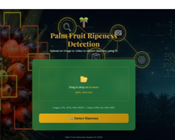
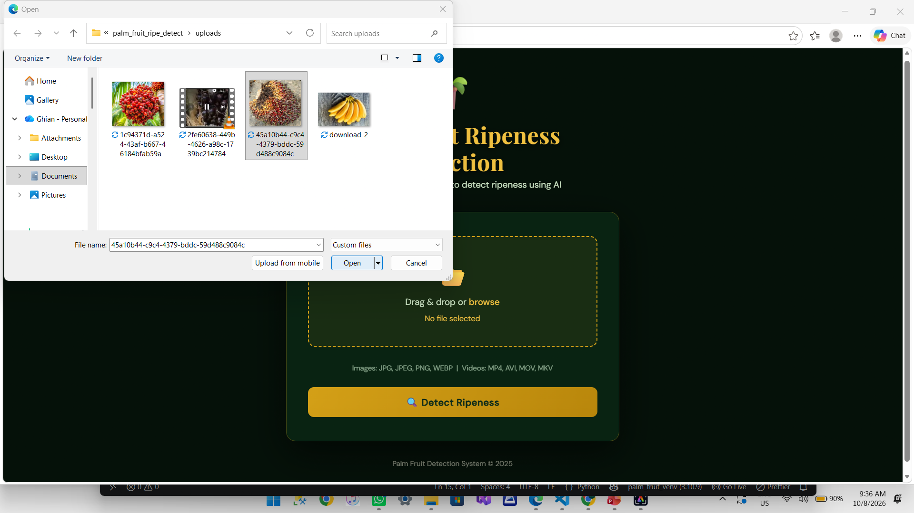
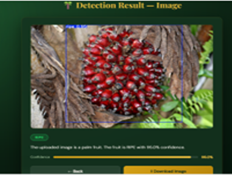
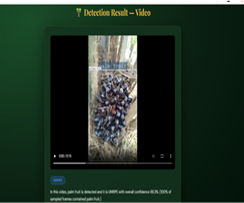
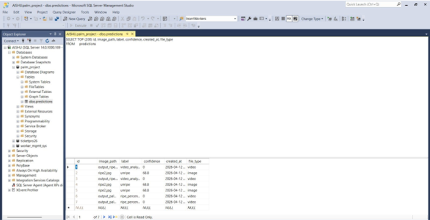

# Palm Fruit Ripeness Detection Using YOLOv8

## 📌 Project Overview

**Palm Fruit Ripeness Detection** is a web-based computer vision application developed to automatically detect palm fruits and identify their ripeness level from images and videos.

The system uses a custom-trained **YOLOv8 object detection model** for palm fruit detection and ripeness classification. A **Flask** web application provides the user interface, while **OpenCV** is used for image and video processing. **Microsoft SQL Server** is integrated to store prediction results.

The application allows users to upload an image or video and obtain detection results with **bounding boxes, ripeness class labels, and confidence scores**.

This project demonstrates the practical use of deep learning and computer vision for agricultural monitoring and palm fruit ripeness analysis.

---

## 🎯 Objectives

- Automatically detect palm fruits from images and videos.
- Classify detected fruits according to their ripeness level.
- Display bounding boxes around detected fruits.
- Display confidence scores for each prediction.
- Support both image and video detection.
- Provide a simple web-based interface using Flask.
- Process images and videos using OpenCV.
- Store prediction information in Microsoft SQL Server.
- Demonstrate a practical computer vision solution for agricultural applications.

---

## ✨ Key Features

- 🌴 Palm fruit detection using YOLOv8
- 🍃 Ripeness classification
- 🖼️ Image-based detection
- 🎥 Video-based detection
- 📦 Bounding box visualization
- 📊 Confidence score display
- 🌐 Flask web application
- 🎞️ OpenCV-based video processing
- 🗄️ Microsoft SQL Server integration
- 💾 Prediction result storage
- 📥 Processed detection output

---

## 🛠️ Technologies Used

| Technology | Purpose |
|---|---|
| **Python** | Application and backend development |
| **YOLOv8 / Ultralytics** | Palm fruit object detection and ripeness classification |
| **Flask** | Web application framework |
| **OpenCV** | Image and video processing |
| **HTML** | Web page structure |
| **CSS** | User interface styling |
| **JavaScript** | Client-side functionality |
| **Microsoft SQL Server** | Prediction result storage |
| **PyODBC** | Python–SQL Server database connectivity |

---

## 🧠 Detection Model

The application uses a custom-trained **YOLOv8 object detection model**.

The model is trained to detect palm fruits and classify them according to their ripeness level.

For each detected fruit, the model provides:

- Bounding box coordinates
- Predicted ripeness class
- Confidence score

The model is integrated into the Flask application using the **Ultralytics YOLO** framework.

### Ripeness Classes

The final trained model uses the following ripeness categories:

- **Ripe**
- **Semi-Ripe**
- **Unripe**

> The class names above should match the final trained model configuration used by the application.

---

## 📂 Dataset

An annotated palm fruit image dataset was used to train the YOLOv8 model.

The dataset contains images of palm fruits representing different ripeness stages. The images were prepared with object-detection annotations containing bounding boxes and class labels.

Additional non-palm fruit images were also considered during dataset preparation to help the system distinguish palm fruits from visually different objects.

The complete dataset is **not included in this public repository**.

### Dataset Preparation

The dataset preparation workflow included:

1. Collecting palm fruit images.
2. Annotating palm fruits with bounding boxes.
3. Assigning the appropriate ripeness class.
4. Preparing the dataset in YOLO-compatible format.
5. Separating the data into training and validation sets.
6. Training the YOLOv8 detection model.
7. Evaluating the trained model and selecting the trained weights for application integration.

---

## 🔄 System Workflow

```text
                    User
                      │
                      ▼
              Flask Web Application
                      │
              ┌───────┴───────┐
              ▼               ▼
        Image Upload      Video Upload
              │               │
              └───────┬───────┘
                      ▼
                OpenCV Processing
                      │
                      ▼
                 YOLOv8 Model
                      │
                      ▼
             Palm Fruit Detection
                      │
                      ▼
             Ripeness Classification
                      │
                      ▼
          Bounding Boxes + Confidence
                      │
                      ▼
               Result Display
                      │
                      ▼
             SQL Server Storage
```

---

## 🌐 Web Application

The project is implemented as a Flask-based web application.

The web interface provides users with options to upload input media and view the processed detection results.

### Application Flow

```text
Home Page
    ↓
Select Image / Video
    ↓
Upload Input
    ↓
YOLOv8 Processing
    ↓
Palm Fruit Detection
    ↓
Ripeness Classification
    ↓
Display Detection Result
    ↓
Store Prediction Information
```

---

## 🖼️ Image Detection

The application supports detection from uploaded images.

When an image is uploaded:

1. The image is received by the Flask application.
2. OpenCV handles the image processing.
3. The YOLOv8 model analyzes the image.
4. Palm fruits are detected.
5. Each detected fruit is assigned a ripeness class.
6. Bounding boxes and confidence scores are generated.
7. The processed result is displayed to the user.
8. Prediction information can be stored in SQL Server.

The output provides a visual representation of the detected palm fruits and their predicted ripeness levels.

---

## 🎥 Video Detection

The application also supports palm fruit detection from uploaded videos.

The uploaded video is processed frame by frame using **OpenCV** and the YOLOv8 model.

For detected palm fruits, the processed frames contain:

- Bounding boxes
- Ripeness class labels
- Confidence scores

The processed frames are combined into a detection-output video that can be viewed through the web application.

### Video Processing Workflow

```text
Video Upload
     ↓
OpenCV Video Capture
     ↓
Frame Extraction
     ↓
YOLOv8 Detection
     ↓
Ripeness Classification
     ↓
Bounding Box + Confidence
     ↓
Processed Frame
     ↓
Output Video
```

---

## 🗄️ Database Integration

Microsoft SQL Server is used to store prediction-related information generated by the application.

The project uses a database named:

```text
palm_project
```

Prediction records can contain information such as:

| Field | Description |
|---|---|
| `id` | Unique prediction identifier |
| `image_path` | Path/reference of the processed media |
| `label` | Predicted ripeness class |
| `confidence` | Model confidence score |
| `created_at` | Prediction date and time |
| `file_type` | Type of uploaded media |

The database integration allows prediction information to be retained for later reference.

Database credentials and local database files are **not included** in this public repository.

---

## 🏗️ Project Structure

```text
Palm-Fruit-Ripeness-Detection/
│
├── README.md
├── requirements.txt
├── .gitignore
│
├── app/
│   ├── app.py
│   │
│   ├── templates/
│   │   ├── index.html
│   │   └── image_result.html
│   │
│   └── static/
│
├── model/
│   └── README.md
│
├── screenshots/
│   ├── 01-home.png
│   ├── 02-image-upload.png
│   ├── 03-image-result.png
│   ├── 04-video-result.png
│   └── 05-database.png
│
├── demo/
│   └── palm-fruit-detection-demo.mp4
│
├── database/
│   ├── schema.sql
│   └── database.png
│
└── docs/
    └── Palm_Fruit_Ripeness_Detection_Report.pdf
```

---

## 📸 Screenshots

### Home Page



### Image Upload



### Image Detection Result



### Video Detection Result



### Database



---

## 🎬 Demo

A demonstration video of the working application is provided in the `demo/` directory.

The demonstration shows the main application workflow, including:

- Application interface
- Image upload
- Video upload
- Palm fruit detection
- Ripeness classification
- Bounding boxes
- Confidence scores
- Final processed output

Demo file:

```text
demo/palm-fruit-detection-demo.mp4
```

---

## 📋 Prerequisites

Before running the project, install the following:

- Python 3.10 or compatible Python 3.x version
- Microsoft SQL Server
- Git
- Required Python packages
- Trained YOLOv8 model weights

---

## ⚙️ Installation

### 1. Clone the Repository

```bash
git clone <YOUR-GITHUB-REPOSITORY-URL>
cd Palm-Fruit-Ripeness-Detection
```

### 2. Create a Virtual Environment

```bash
python -m venv venv
```

### 3. Activate the Virtual Environment

For Windows:

```bash
venv\Scripts\activate
```

### 4. Install Required Packages

```bash
pip install -r requirements.txt
```

### 5. Configure the YOLOv8 Model

Place the trained YOLOv8 model weights in the location expected by the application.

The trained model weights are not included in this public repository.

Refer to:

```text
model/README.md
```

for model-related information.

### 6. Configure SQL Server

Create the required SQL Server database and table structure.

The database schema is provided in:

```text
database/schema.sql
```

Update the local database connection configuration according to your SQL Server setup.

**Do not commit database passwords or other sensitive credentials to GitHub.**

### 7. Run the Application

If `app.py` is located inside the `app/` directory:

```bash
python app/app.py
```

Then open the local Flask URL shown in the terminal.

---

## 🗃️ Database Setup

1. Open Microsoft SQL Server.
2. Create the `palm_project` database.
3. Execute the SQL script from:

```text
database/schema.sql
```

4. Configure the SQL Server connection in the application.
5. Start the Flask application.

---

## 📦 Requirements

The Python packages required by the application are listed in:

```text
requirements.txt
```

Install them using:

```bash
pip install -r requirements.txt
```

The repository intentionally does **not** include the complete Python virtual environment.

---

## 🔐 Security and Repository Scope

This repository is intended as a public project showcase.

The following items are intentionally excluded:

- Python virtual environment
- Complete training dataset
- Training runs and experiment outputs
- Database backup files
- SQL Server data files
- Passwords and database credentials
- API keys and secret configuration
- Uploaded user files
- Generated temporary results
- Private trained model weights

The `.gitignore` file is used to prevent common local and generated files from being committed accidentally.

---

## ⚠️ Limitations

- Detection performance may vary depending on image quality and lighting conditions.
- Performance can be affected by fruit size, camera angle, occlusion, and background conditions.
- Very small or partially visible fruits may be more difficult to detect.
- Model performance depends on the quality and diversity of the training dataset.
- The system is intended as an academic and demonstration project and requires further real-world validation before large-scale deployment.

---

## 🚀 Future Enhancements

Possible future improvements include:

- Real-time camera-based palm fruit detection
- Mobile application integration
- Larger and more diverse datasets
- Further model optimization
- Improved detection accuracy
- Cloud deployment
- Edge-device deployment
- Automated plantation monitoring
- Real-time agricultural monitoring
- Integration with agricultural management systems

---

## 📄 Project Report

A detailed project report containing the project methodology, system design, implementation, results, screenshots, database integration, limitations, and future enhancements can be included in:

```text
docs/Palm_Fruit_Ripeness_Detection_Report.pdf
```

---

## 🎓 Academic Project

This project was developed as an academic final-year project to demonstrate the practical application of:

- Deep Learning
- Computer Vision
- Object Detection
- Web Application Development
- Video Processing
- Database Integration

---

## 👩‍💻 Author

**Aishwarya**

B.E. Computer Science and Engineering

---

## 📌 Disclaimer

This project is developed for academic, learning, and demonstration purposes. The system demonstrates the use of YOLOv8-based computer vision for palm fruit detection and ripeness classification.

The model and application should be further evaluated and validated with diverse real-world data before being used in production agricultural environments.
